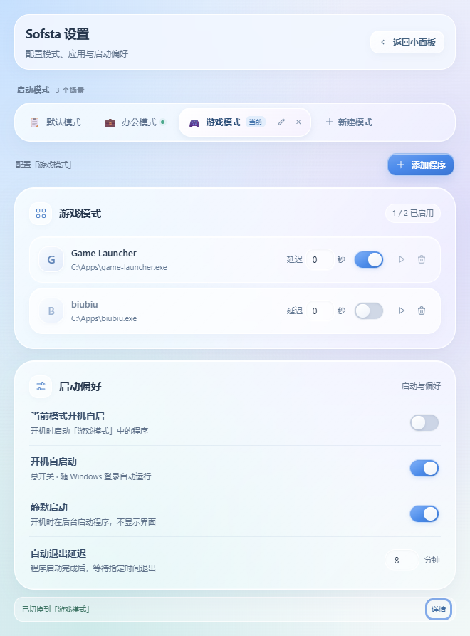

# Sofsta

**把常用软件组合成模式，在桌面上一键切换。**

Sofsta 是一款面向 Windows 的应用启动与模式切换工具。你可以准备好“办公”“游戏”“专注”等软件清单，通过一个采用 Liquid Glass 风格的小面板查看当前模式、启动应用，或先关闭旧模式的软件，再进入新模式。


## 功能

- **桌面小面板**：默认 380 × 340，最小 320 × 260；主界面只显示模式、当前状态和操作按钮。
- **可选窗口置顶**：点击右上角图钉保持面板可见，置顶偏好会在下次打开时恢复。
- **模式管理**：自定义模式名称、图标、主题色和独立的应用清单。
- **软件选择列表**：搜索本机可发现的桌面软件，连续添加；也支持手动选择程序文件。
- **模式切换**：请求旧模式的软件退出，确认退出后，按设定延迟启动目标模式。
- **开机启动**：可以为多个模式分别启用登录后自动启动，并设置后台流程的退出延迟。
- **运行反馈**：显示启动失败、未退出的软件和权限问题，支持重试及明确选择强制结束。

## 安装

支持 Windows 10 / 11，需要 Microsoft Edge WebView2 Runtime。

项目发布入口：[Releases](https://github.com/jupro2/Sofsta/releases)。本次发布提供 Windows x64 安装版 exe 和免安装 exe；免安装版需要系统已安装 WebView2 Runtime。完整本地构建还支持 Windows Installer（`.msi`）。

## 快速上手

### 1. 配置模式与软件

1. 打开 Sofsta，点击右上角的 **设置**。
2. 点击 **新建模式**，填写名称并选择图标、颜色，例如“办公模式”。
3. 选中模式，点击 **添加程序**，搜索并添加需要的软件。没有列出的程序可通过 **手动选择文件** 添加。
4. 在应用清单中调整启用状态和启动延迟；每个程序可单独测试启动或删除。
5. 点击 **返回小面板**。窗口会恢复配置前的尺寸和桌面位置。



### 2. 启动与切换

在小面板中选中模式，再点击操作按钮。**选择模式本身不会启动或关闭软件。**

| 操作 | 行为 |
| --- | --- |
| 一键启动 | 启动所选模式中已启用的程序；已经运行的实例纳入管理，不重复打开 |
| 补充启动 | 为当前模式补充尚未运行的程序 |
| 切换到另一个模式 | 先请求旧模式的软件退出，全部退出后再启动目标模式 |
| 查看处理 | 展开失败原因、仍在运行的软件，以及重试或强制结束入口 |

例如，从办公切换到游戏：先选中“游戏模式”，再点击 **切换到「游戏模式」**。两个模式共有的、已纳入管理的程序也会先关闭，再重新启动。

模式较多时可以在模式区域内滚动。设置页面按 `Esc` 可返回小面板；打开软件选择、模式编辑或运行详情弹窗时，`Esc` 会先关闭弹窗。

### 3. 配置开机启动

在设置中选中需要自动运行的模式，开启 **当前模式开机自启**，再开启 **开机自启动** 总开关。多个模式可以同时启用。

Windows 登录后，Sofsta 会在后台依次启动这些模式中已启用的程序。各程序的延迟为**逐项等待、依次累加**，并非都从登录时刻开始计时。

**自动退出延迟**只针对开机后台启动流程：所有启动尝试结束后等待指定分钟数，再退出 Sofsta 的后台进程；已启动的应用继续运行。手动打开的桌面小面板不会因此计时退出。

## 软件关闭与权限

当前模式清单中已启用的软件，无论是 Sofsta 启动的，还是此前手动打开的，都会按**完整 exe 路径**匹配并纳入管理。切换前会重新扫描当前模式，补充漏记的实例。清单外的软件及路径不同的同名程序不会仅因名称相同被关闭。

切换前请先保存工作内容。Sofsta 会请求程序正常退出；如果出现保存提示、软件仅缩到托盘或没有响应，等待约 8 秒后会暂停切换，目标模式的程序不会继续启动。此时可保存并手动退出后重试，或选择 **强制结束并切换**。强制结束可能丢失未保存的内容。

需要管理员权限的软件，在普通启动返回 Windows 错误 740 后，会通过系统授权流程启动并显示 UAC 确认。取消授权会明确提示未启动。关闭已提权的软件若遇到权限不足，可按提示以管理员身份重新打开 Sofsta 后重试。

Sofsta 记录 PID 和进程创建时间，关闭前会核验进程身份，避免把已被重新使用的 PID 当作旧程序。管理器重新打开后，也会继续核验保存的运行记录。

## 设置与数据位置

为兼容旧版，Sofsta 继续使用原有的数据目录，无需重新添加模式和软件：

```text
%APPDATA%\AutoStartManager\
├── config.json    # 模式、应用、启动参数与偏好
├── runtime.json   # 当前模式和已记录的进程身份
└── runtime.lock   # 协调多窗口和后台启动操作
```

置顶偏好保存在应用的 WebView 本地存储中，旧版偏好会自动沿用。应用标识保持兼容；新的产品名、窗口标题、程序和安装包名称使用 Sofsta。

改名或移动可执行文件后，可将 **开机自启动** 总开关关闭再打开，以更新启动路径。重新设置时会使用 `Sofsta` 启动项，并清理旧版 `AutoStartManager` 启动项。

配置结构示例：

```json
{
  "modes": [
    {
      "id": "mode-example",
      "name": "办公模式",
      "icon_emoji": "💼",
      "color": "#3B82F6",
      "auto_start": false,
      "apps": [
        {
          "id": "app-example",
          "name": "Example",
          "path": "C:\\Apps\\Example\\Example.exe",
          "args": "",
          "working_dir": "C:\\Apps\\Example",
          "enabled": true,
          "delay_seconds": 5
        }
      ]
    }
  ],
  "exit_delay_minutes": 5,
  "auto_start_enabled": false,
  "silent_launch": true
}
```

`working_dir` 是可选字段，旧配置可以继续读取。通常直接在设置界面修改即可。

## 本地开发

### 环境

- Windows 10 / 11。
- Node.js `20.19+`（20.x）或 `22.12+`，与当前 Vite 的版本要求一致。
- Rust `1.88+`，使用 Windows MSVC 工具链。
- Visual Studio C++ Build Tools，包含桌面 C++ 工具和 Windows SDK。
- Microsoft Edge WebView2 Runtime。

在项目根目录执行：

```powershell
# 按锁文件安装前端依赖
npm.cmd ci

# 启动桌面开发模式
npm.cmd run tauri dev

# 构建安装包
npm.cmd run tauri build
```

安装包输出到 `src-tauri/target/release/bundle/`。Rust 程序包及默认可执行文件名为 `sofsta`，桌面产品名称为 **Sofsta**。

### 验证

```powershell
# TypeScript 检查及前端构建
npm.cmd run build

# 后端与 Windows 进程管理测试
cargo test --manifest-path src-tauri/Cargo.toml
```

默认测试使用模拟进程或独立测试窗口。读取本机配置的诊断测试、可能显示 UAC 并启动真实软件的交互测试默认忽略，需明确选择后执行。

### 项目结构

```text
src/
├── App.vue                    # 小面板与设置页面
├── components/                # 模式、应用、运行反馈等界面
├── composables/               # 窗口尺寸、置顶及弹窗焦点管理
└── stores/apps.ts             # 前端状态和后端调用
src-tauri/
├── src/config.rs              # 配置读写及旧格式迁移
├── src/runtime.rs             # 运行记录与模式切换流程
├── src/processes.rs           # Windows 进程识别、启动、提权与关闭
├── src/installed_apps.rs      # 软件发现接口
├── src/discover_apps.ps1      # 开始菜单及 App Paths 只读扫描
├── src/autostart.rs           # Windows 登录启动项
└── tauri.conf.json            # 产品名称、窗口及打包配置
```

技术栈：**Tauri 2 · Rust · Vue 3 · TypeScript · Pinia · Tailwind CSS · Vite**。

## 已知限制

- 软件列表来自当前用户及所有用户的开始菜单快捷方式，以及 32/64 位 App Paths 注册表，不遍历整个磁盘；部分商店应用、便携软件和失效快捷方式可能不会显示。
- 进程追踪只扩展已确认的同一可执行文件子进程。跨 exe 启动器、转交给已有进程的启动请求及部分提权场景可能无法完整追踪，不能保证关闭所有后台辅助进程。
- 目前开机启动项使用 `--silent` 后台流程；“静默启动”开关的非静默分支尚未实现，关闭该开关不会改为开机显示小面板。
- 目前面向 Windows，不提供 macOS 或 Linux 的模式切换实现。

## 许可证

MIT License.
